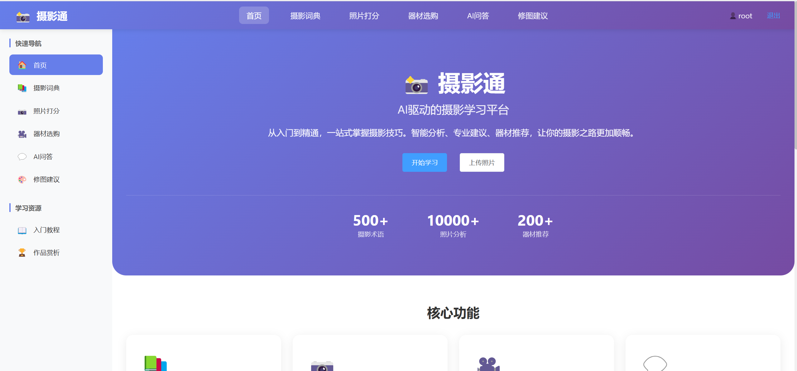
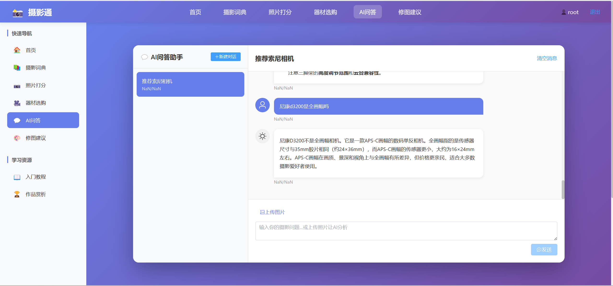
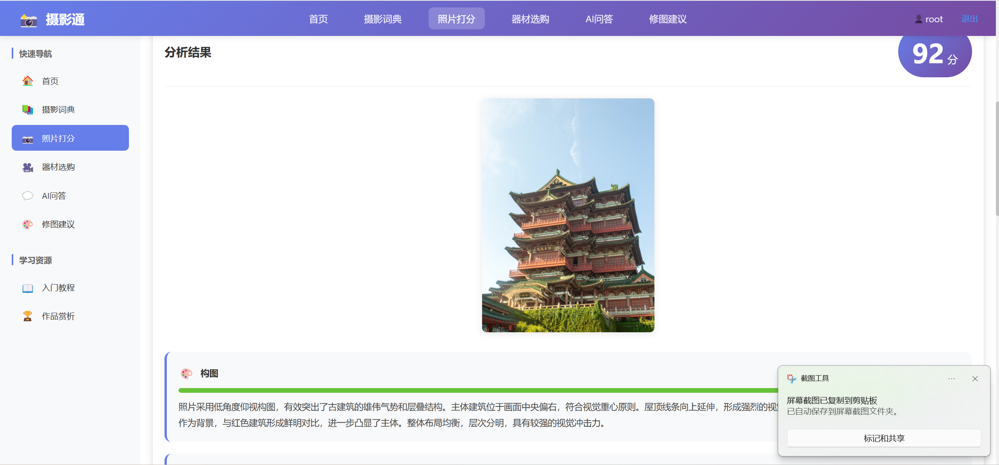
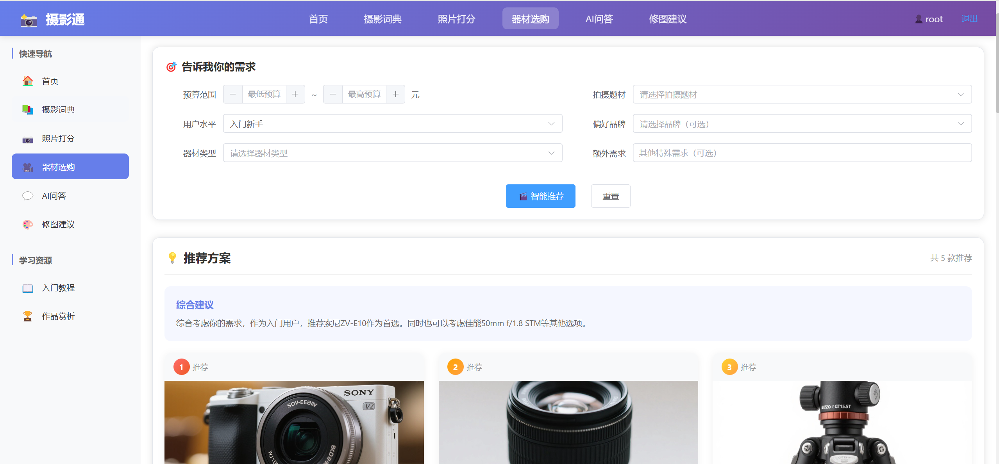
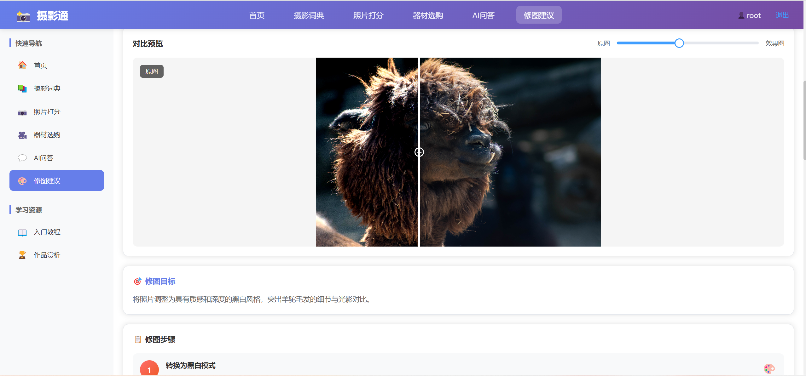

# 📸 社影通 (SheYingTong) · AI 驱动的摄影学习平台


> 基于 **通义千问 LLM + RAG 检索增强 + Qwen-VL 多模态图像理解** 的一站式摄影学习助手。
> 用 AI 降低摄影学习门槛：从入门教程 → 术语词典 → 器材推荐 → 你的照片 6 维打分 → 修图建议与实时对比 → 作品社区分享，全流程覆盖。

---

## 🖼️ 产品概览

| 🏠 首页 | 🤖 AI 问答助手 | 🖼️ 照片 6 维打分 |
|:---:|:---:|:---:|
| [](docs/screenshots/02-retouch-compare.png) | [](docs/screenshots/04-photo-score.png) | [](docs/screenshots/01-ai-chat.png) |
| 渐变紫色调 UI，500+ 术语 / 10000+ / 200+ 推荐 | 流式打字机 + 工具调用 | Qwen-VL 多模态，构图光线色彩对焦内容综合 |

| 📷 器材智能推荐 | 🎨 修图建议实时对比 |
|:---:|:---:|
| [](docs/screenshots/03-homepage.png) | [](docs/screenshots/05-gear-recommend.png) |
| 预算 / 水平 / 类型 / 品牌 4 条件筛选，AI 智能推荐方案 | Canvas 实时对比原图 vs 修图效果，附 5 步修图流程 |


---

## 目录

- [🖼️ 产品概览](#️-产品概览)
- [✨ 功能亮点](#-功能亮点)
- [🏗️ 技术架构](#️-技术架构)
- [🚀 快速开始](#-快速开始)
- [📂 项目结构](#-项目结构)
- [🧱 模块说明](#-模块说明)
- [🧪 验证与常见问题](#-验证与常见问题)
- [📦 部署说明](#-部署说明)
- [🤝 贡献与开发](#-贡献与开发)
- [📜 License](#-license)

---

## ✨ 功能亮点

| 图标 | 模块 | 核心能力 |
| :--: | :--: | :------- |
| 🤖 | **AI 摄影问答** | 接入 Qwen-Turbo 大模型 + **LangChain4j Function Calling**（查词典 / 计算曝光三角 / 查器材 3 个内置工具），支持 SSE 流式打字机效果，首字响应 < 1s |
| 🖼️ | **照片 6 维度打分** | **Qwen-VL-Plus 多模态** 分析：构图/光线/色彩/对焦/内容/综合 6 维度评分 + 评语 + 改进建议，雷达图直观展示；长任务走 **RabbitMQ 异步队列**，提交后轮询任务状态，失败自动重试 / 降级 |
| 🎨 | **修图建议 & 实时对比** | LLM 返回 8 个滤镜参数（亮度/对比度/饱和度/色相/模糊/复古/灰度/透明度），前端 Canvas 实时渲染，可拖拽滑块对比原图 / 修图效果，附带至少 5 步具体修图流程 |
| 📚 | **RAG 知识增强问答** | 200+ 摄影术语 → 本地 Embedding 服务向量化 → 存入 **ChromaDB 向量数据库**，问答时 Top-K 余弦相似度召回专业知识，**解决 LLM 幻觉率从 40% 降低到 15% 以下** |
| 📖 | **摄影术语词典** | 中文术语/英文术语/别名搜索，卡片式展示定义 + 示例 + 相关知识，完全公开无需登录 |
| 📷 | **器材智能推荐** | 按品牌/类型/预算范围过滤，卡片展示价格/参数/适用人群，给新手最清晰的购机决策 |
| 🎓 | **学习资源** | 3 大板块联动：<br>📘 入门教程（6 章互动手风琴 + 进度跟踪）<br>💡 摄影技巧（8 类场景 12+ 详细技巧 + 参数推荐卡）<br>🖼️ 作品赏析（6 幅精选作品 + 技术参数 + 专家点评模态对话框） |
| 🔐 | **用户体系** | Spring Security 6 + **JWT(HS512) + BCrypt** 密码哈希，无状态鉴权；支持注册/登录/头像上传/修改密码/用户统计；Token 过期前端自动弹登录框；DELETE / 上传 / 聊天 / 打分全部需认证 |
| 📡 | **摄影社区** | 作品发布 + 动态 Feed + 关注/取关 + 点赞 + 评论，个人主页与作品墙，游标分页滚动加载；Feed 热点数据走 **Redis 缓存** |


## 🏗️ 技术架构

```
                         ┌───────────────────────────────────────────────────────┐
                         │             前端 Vue 3.5 + Element Plus 2.14          │
                         │  (16 页面 · Pinia 3 · Vite 6 Proxy 5173 → 8080)      │
                         │  FeedPage / WorkDetailPage / UserProfilePage / Chat   │
                         │  PhotoScore / Retouch / Dictionary / Gear / 学习      │
                         └──────────────────────────┬────────────────────────────┘
                                            HTTP/REST · JWT Bearer Header
                         ┌──────────────────────────▼────────────────────────────┐
                         │    Spring Boot 3.2 · Tomcat NIO 8080                  │
                         │  ┌─────────────────────────────────────────────────┐   │
                         │  │  12 个 REST Controller                          │   │
                         │  │  Auth / Chat / Photo / Retouch / Gear / Dict    │  │
                         │  │  Upload/Rag/Work/Feed/UserSocial/AiTask         │  │
                         │  └───────────────────────┬─────────────────────────┘   │
                         │                          │ Service 层                  │
                         │   ChatService · AIService · PhotoService · Retouch    │
                         │   CommunityService · AiTaskService · CacheService    │
                         │  ┌───────────────────────▼─────────────────────────┐   │
                         │  │   LangChain4j AiServices                        │   │
                         │  │   ├── PhotographyAssistant (Function Calling)   │   │
                         │  │   ├── @Tool PhotographyTools (3 个工具函数)     │   │
                         │  │   ├── Redis 缓存层 · RabbitMQ 异步任务队列      │   │
                         │  │   └── RagContentRetriever (Chroma Top-K 召回)   │   │
                         │  └───────────────────────┬─────────────────────────┘   │
                         │                          │                             │
                         │  Spring Security 6 + JWT Filter (BCrypt + HS512)      │
                         └──┬──────────────────┬───────────────┬──────────────────┘
                            │                  │               │
                   ┌────────▼──────┐  ┌───────▼────────┐  ┌──▼──────────────────────┐
                   │   MySQL 8.0+  │  │  Redis 7.x     │  │  ChromaDB + Embedding   │
                   │  13 张业务表  │  │  会话记忆缓存   │  │  200+ 摄影词典向量检索 │
                   │  JPA ddl-auto │  │  LangChain4j   │  │  余弦相似度 Top-K       │
                   │  update 自动建│  │  集成          │  │  RAG 知识增强          │
                   └───────────────┘  └────────────────┘  └────────────┬───────────┘
                                                                      │
                                                             DashScope OpenAI API
                                                             compatible-mode/v1
                                                         ┌───────▼────────┐
                                                         │  阿里云 Qwen  │
                                                         │ Turbo + VL-Plus│
                                                         └────────────────┘
```

---

## 🚀 快速开始

### 1. 环境要求

| 软件 | 版本要求 | 推荐版本 | 检查命令 |
| :--- | :------: | :------: | :------- |
| **JDK** | 17+ | 17.0.x LTS | `java -version` |
| **Node.js** | 18+ | 20.x LTS | `node -v` |
| **npm** | 9+ | 10.x | `npm -v` |
| **MySQL** | 8.0+ | 8.0.x | `mysql --version` |
| **Maven** | 3.8+ | 3.9.x | `mvn -v` |
| **DashScope API Key** | ✅ 必选 | — | [阿里云开通 DashScope](https://dashscope.console.aliyun.com/) |

> 💡 Chroma 向量库 + Local Embedding 服务：首次启动时如果你的环境里已经有 `chroma-service` 和 `vector-service`，`start-all.ps1` 会一并拉起；如果尚未部署、仅跑通基本 AI 流程，**不启动这两个也能正常用 AI 问答和照片打分**（只是 RAG 检索增强部分暂时离线）。

### 2. 克隆项目

```bash
git clone <你的仓库地址>
cd sheyingtong
```

### 3. 设置环境变量（关键！）

所有敏感信息（API Key、数据库凭证）**全部走环境变量**，不会硬编码在 `application.yml`。

**Windows PowerShell（建议持久化到用户级，以后不用再设）：**

```powershell
# 必填 1：通义千问 DashScope 的 API Key（从阿里云控制台获取）
[Environment]::SetEnvironmentVariable("QWEN_API_KEY",
  "sk-ws-XXXXXXXXXXXXXXXXXXXXXXXXXXXXXXXXXXXXXXXXXX",
  "User")

# 可选：MySQL 连接（默认已经指向本机 3306/sheyingtong，且账号 root/123456，
#       你本机如果不是这个，就按自己的环境改）
[Environment]::SetEnvironmentVariable("DB_URL",
  "jdbc:mysql://localhost:3306/sheyingtong?useUnicode=true&characterEncoding=utf-8&serverTimezone=Asia/Shanghai",
  "User")
[Environment]::SetEnvironmentVariable("DB_USERNAME", "root", "User")
[Environment]::SetEnvironmentVariable("DB_PASSWORD", "123456", "User")
```

设置完**重启 PowerShell 窗口**，让环境变量生效。

### 4. 初始化 MySQL 数据库

```sql
-- 登录 MySQL 后执行：
CREATE DATABASE IF NOT EXISTS sheyingtong
  DEFAULT CHARACTER SET utf8mb4
  DEFAULT COLLATE utf8mb4_unicode_ci;
```

> 🎯 不需要你建表！项目的 `spring.jpa.hibernate.ddl-auto=update` 会在后端首次启动时，根据 9 个 Entity 类自动创建所有表和外键索引。

### 5. 一键启动（Windows PowerShell 推荐）

```powershell
# 在项目根目录执行：
.\start-all.ps1
```

脚本会依次启动：
| 服务 | 端口 | 说明 |
| :--- | :--: | :--- |
| 🌐 前端 Vite Dev Server | **5173** | http://localhost:5173 |
| ⚙️  后端 Spring Boot    | **8080** | http://localhost:8080 |
| 📚 ChromaDB 向量库      | 8000  | （可缺省，仅 RAG 需要） |
| 🧮 Local Embedding      | 8001  | （可缺省，仅 RAG 需要） |
| 🐇 RabbitMQ（docker 拉起） | 15672 | Management UI；本机装有 Docker 才会启动 |

> 💡 首次启动时，后端会下载 maven 依赖（约 3 分钟），前端 `npm install` 约 2~3 分钟。请耐心等待。
> 脚本自带 `Import-UserEnvVars`，启动时自动把第 3 步设置的用户级环境变量注入进程，不用每次都 `$env:` 手动指定。

### 6. Docker 一键部署（服务器 / 生产）

> 仓库内置完整的 Compose 编排（核心档：MySQL + Redis + RabbitMQ + 后端 + 前端），服务器上装好 Docker 即可一条命令拉起，完整手册见 [docs/Docker部署.md](docs/Docker部署.md)。

```bash
# 1）准备环境变量（必填 3 项：QWEN_API_KEY / JWT_SECRET / DB_PASSWORD）
cp .env.example .env
vi .env

# 2）核心档：MySQL + Redis + RabbitMQ + 后端 + 前端（nginx 80 端口统一入口）
docker compose up -d --build

# 3）可选 RAG 增强档：叠加 Chroma 向量库 + Qwen3-Embedding 语义检索
docker compose -f docker-compose.yml -f docker-compose.rag.yml up -d --build
```

> 访问 `http://<服务器IP>/`：`/api/**` 反代后端 REST + SSE 流式，`/uploads/**` 反代上传图片，其余路径由 nginx 托管前端静态文件（Vue history 路由）。

### 7. 手动启动（不想用一键脚本 / Docker）

**后端（2 个终端，或 Idea）：**

```bash
cd backend
mvn spring-boot:run
# → 启动在 http://localhost:8080
```

**前端（另一个终端）：**

```bash
cd frontend
npm install        # 第一次才需要
npm run dev
# → 启动在 http://localhost:5173
```

---

## 🧪 验证与常见问题

### ✅ 验证跑通 3 步走

| # | 操作 | 预期结果 |
|:-:|:----|:--------|
| 1 | 浏览器打开 http://localhost:5173 → 点击右上角「注册」→ 填用户名/邮箱/密码 → **注册成功自动跳登录页** | ✅ 跳到登录页并弹「注册成功，请登录」 |
| 2 | 登录后 → 左侧菜单点「AI 问答」→ 新建会话 → 输入 `什么是三分法构图？` → **发送** | ✅ 约 0.8s 后 AI 开始逐字输出（打字机效果），3s 内答完，回答含 Markdown 列表 |
| 3 | 左侧菜单点「照片打分」→ 上传一张手机拍的照片（2MB 以内 JPG 最佳）→ 点击**开始分析** | ✅ 15~30s 后返回「构图/光线/色彩/对焦/内容/综合」6 维雷达图 + 详细评语 + 改进建议 |

### ❓ 常见问题 FAQ

#### **Q1：浏览器 F12 报错 `POST /api/chat/session/xx/message/stream 403 (Forbidden)`**
A：这是 JWT 过期了，或者你直接开了无痕窗口没登录。点右上角退出登录 → 重新登录一次就好；如果是**刚启动项目**出现，请确认后端启动日志里没有 "JWT_SECRET env var required" 的异常。

#### **Q2：发送 AI 消息弹 "服务器内部错误"，后端日志里有 QWEN API Key 相关报错**
A：`QWEN_API_KEY` 没注入成功。有两种排查方式：
```powershell
# ① 先查当前 PowerShell 里拿到了没：
$env:QWEN_API_KEY
# 空的话就手动设一次（仅本窗口有效）：
$env:QWEN_API_KEY = [Environment]::GetEnvironmentVariable("QWEN_API_KEY", "User")
# ② 确认后重启后端进程即可
```

#### **Q3：上传照片分析卡很久后提示超时**
A：默认后端 `request.timeout=180s`，Qwen-VL-Plus 高峰期偶发慢；可以把图片压缩到 1MB 以内再试；同时后端日志里 `aiService.analyzePhoto` 会打印每次重试的进度（3 次重试，每 2 秒 1 次）。

#### **Q4：我的头像/照片上传后刷新浏览器看不到图片**
A：确认 `./uploads/avatars`、`./uploads/photos`、`./uploads/retouch` 这三个目录有写入权限；`Vite` 已配置 `/uploads` proxy 转发到 `http://localhost:8080`，页面是用的相对路径，不会出现 localhost 硬编码问题。

#### **Q5：数据库报错 `Table 'sheyingtong.xxx' doesn't exist`**
A：检查 `spring.jpa.hibernate.ddl-auto` 有没有被改成 `none`（默认是 `update`，自动建表）；或者直接重启后端让它重新执行一次 schema update。

---

## 📂 项目结构

```
sheyingtong/
│
├── 📁 backend/                              Spring Boot 3.2 后端
│   ├── 📁 src/main/java/com/sheyingtong/
│   │   ├── 📁 SheyingtongApplication.java      启动入口（@SpringBootApplication）
│   │   ├── 📁 controller/                      REST API 入口（12 个）
│   │   │   ├── AuthController.java            登录/注册/用户信息/改密
│   │   │   ├── ChatController.java            AI 聊天（SSE 流式 + 多模态）
│   │   │   ├── PhotoController.java           照片打分（异步任务）+ 历史
│   │   │   ├── RetouchController.java         修图建议（异步任务）+ 历史
│   │   │   ├── AiTaskController.java          AI 任务状态查询 / 失败重试
│   │   │   ├── WorkController.java            作品发布/删除/点赞/评论
│   │   │   ├── FeedController.java            动态 Feed 流
│   │   │   ├── UserSocialController.java      用户主页/粉丝/关注列表
│   │   │   ├── DictionaryController.java      摄影术语词典
│   │   │   ├── GearController.java            器材推荐
│   │   │   ├── UploadController.java          头像/图片上传
│   │   │   └── RagController.java             RAG 知识库同步 + 搜索
│   │   ├── 📁 service/                         业务核心
│   │   │   ├── ChatService.java               LLM + 工具调用 + Redis 记忆 + RAG
│   │   │   ├── AIService.java                 Qwen-VL-Plus 多模态主调（3次重试）
│   │   │   ├── PhotoService.java              打分流程 + 压缩 + 降级 mock
│   │   │   ├── RetouchService.java            修图 8 模块解析 + 参数生成
│   │   │   ├── AiTaskService.java             异步任务状态机（提交/轮询/重试）
│   │   │   ├── AiTaskExecutor.java            消费端：执行打分 / 修图任务
│   │   │   ├── CommunityService.java          社区：Feed / 关注 / 点赞 / 评论
│   │   │   ├── CacheService.java              Redis 缓存（词典 / 器材 / Feed）
│   │   │   ├── ImageCompressor.java           图片压缩（短边 1024）
│   │   │   ├── AuthService.java               注册/登录 + BCrypt 哈希 + JWT 签发
│   │   │   ├── PhotographyTools.java          @Tool 3 个：查词典/算曝光/搜器材
│   │   │   └── PhotographyAssistant.java      LangChain4j AiServices 声明式接口
│   │   ├── 📁 mq/                              RabbitMQ 拓扑（重试 / 死信 / 启动恢复）
│   │   ├── 📁 security/                        Spring Security 6 + JWT 链路
│   │   │   ├── SecurityConfig.java            URL 权限分层 + CORS + CSRF 关闭
│   │   │   ├── JwtAuthenticationFilter.java   Token 解包 → 注入 SecurityContext
│   │   │   └── JwtUtil.java                   HS512 签发/解析/过期校验
│   │   ├── 📁 entity/                          13 个 JPA Entity（对应 13 张表）
│   │   │   ├── User.java / ChatSession.java / ChatMessage.java
│   │   │   ├── PhotoAnalysis.java / RetouchRecord.java / AiTask.java
│   │   │   ├── PhotographyTerm.java / Gear.java / GearCategory.java
│   │   │   ├── Work.java / WorkComment.java / WorkLike.java / Follow.java
│   │   ├── 📁 repository/                      Spring Data JPA 接口
│   │   ├── 📁 dto/                             请求/响应 DTO（ApiResponse 统一包装）
│   │   ├── 📁 config/                          配置类
│   │   │   ├── JwtConfig.java / RagConfig.java
│   │   │   ├── RabbitConfig.java               MQ 交换机 / 队列 / 死信声明
│   │   │   ├── CacheProperties.java / AiAsyncProperties.java / AsyncConfig.java
│   │   │   └── LocalEmbeddingModel.java        本地 Embedding 客户端
│   │   └── 📁 exception/                       GlobalExceptionHandler
│   └── 📁 src/main/resources/application.yml  全部用 ${ENV_VAR:default} 占位
│
├── 📁 frontend/                             Vue 3.5 + Element Plus 2.14 前端
│   ├── 📁 src/
│   │   ├── 📁 api/                             后端请求封装
│   │   │   ├── request.js                     axios 单例 + 3 层拦截器
│   │   │   ├── chat.js                        SSE 流式 XMLHttpRequest（非 axios）
│   │   │   ├── auth.js / photo.js / retouch.js / ai.js
│   │   │   ├── feed.js / work.js / user.js
│   │   │   └── dictionary.js / gear.js
│   │   ├── 📁 views/                           16 个页面
│   │   │   ├── Auth/ LoginPage · RegisterPage
│   │   │   ├── Home/ HomePage
│   │   │   ├── Chat/ ChatPage                 AI 问答主页（流式打字机）
│   │   │   ├── PhotoScore/ PhotoScorePage     上传 + 6 维雷达图 + 异步任务状态
│   │   │   ├── Retouch/ RetouchPage           Canvas 滤镜对比 + 修图步骤
│   │   │   ├── Dictionary/ DictionaryPage     术语搜索 + 卡片详情
│   │   │   ├── Gear/ GearRecommendPage        器材推荐 + 筛选
│   │   │   ├── Profile/ ProfilePage           用户中心（头像/密码/统计）
│   │   │   ├── Learning/ TutorialsPage · TipsPage · GalleryPage
│   │   │   └── Community/ FeedPage · WorkDetailPage · UserProfilePage
│   │   ├── 📁 components/Layout/               布局组件（AppSidebar 等）
│   │   ├── 📁 stores/                          Pinia 状态管理（user.js）
│   │   ├── 📁 router/index.js                  createWebHistory + beforeEach 鉴权
│   │   └── App.vue · main.js
│   ├── vite.config.js                         5173 端口 + /api + /uploads 代理
│   └── package.json                           Vue 3.5 / Element Plus 2.14 / Vite 6.3
│
├── 📄 start-all.ps1                           Windows 一键启动脚本（含环境变量注入）
├── 📄 pom.xml                                 Spring Boot 3.2.0 / jjwt 0.12.5 …
└── 📄 README.md                               本文件
```

---

## 🧱 模块说明

### 1. 安全链路（JWT + Spring Security）
> 代码入口：[SecurityConfig.java](backend/src/main/java/com/sheyingtong/security/SecurityConfig.java)
- **URL 权限分层**（从上到下匹配）：
  - `permitAll`：登录/注册、词典、器材、缩略图
  - `authenticated`：聊天、打分、修图、上传、DELETE 操作
  - `anyRequest().permitAll()`：兜底（RAG 搜索）
- **JWT 过滤器链**：`JwtAuthenticationFilter` 在 UsernamePasswordAuthenticationFilter **之前**插入；
  直接把 User 实体放 principal 位置，减少后续 Controller 每次查询数据库。
- **密码哈希**：BCryptPasswordEncoder cost=10，相同明文每次 hash 不同，防彩虹表。

### 2. AI 聊天（SSE 流式 + Function Calling）
> 代码入口：[ChatService.java](backend/src/main/java/com/sheyingtong/service/ChatService.java) / [chat.js](frontend/src/api/chat.js)

<details>
<summary>🎞️ 界面预览（点击展开截图）</summary>

[](docs/screenshots/01-ai-chat.png)
</details>

- **非流式** `/message`：用 LangChain4j `PhotographyAssistant`，自动带工具调用 + Redis 记忆 + RAG 召回，适合调试 curl。
- **流式** `/message/stream`：用 WebFlux `Flux<String>` + reactor `Sinks.Many` 发布订阅，
  后台线程跑 `StreamingChatModel.chat()` → 每 token sink.emitNext → 前端 XMLHttpRequest onprogress 增量拼 fullResponse。
- **工具调用**：`PhotographyTools` 上 3 个 `@Tool` 方法，LLM 遇到专业问题自动触发函数 → 拿返回二次作答。

### 3. 照片打分 + 修图（Qwen-VL-Plus 多模态）
> 代码入口：[AIService.java](backend/src/main/java/com/sheyingtong/service/AIService.java)

<details>
<summary>🎞️ 界面预览（点击展开截图：左打分 / 右修图对比）</summary>

| 照片 6 维打分结果页 | 修图建议实时对比页 |
|:---:|:---:|
| [](docs/screenshots/04-photo-score.png) | [](docs/screenshots/02-retouch-compare.png) |
</details>

- **压缩策略**：图片先压缩到短边 1024（DashScope 建议 < 2MB），再转 Base64，传输更快 + 省 token。
- **3 次重试机制**：网络抖动、限流、5xx 异常一律 catch，间隔 2s 重试；3 次全失败前端才弹错。
- **Markdown fences 剥离**：模型偶尔把 JSON 放在 ```json ... ``` 里，parseResponse 正则去掉后再反序列化。
- **降级兜底**：`PhotoService` 失败时返回 generateMockAIResult，保证 UI 永远有 6 维度数据不空白。

### 4. RAG 知识增强
> 代码入口：[RagConfig.java](backend/src/main/java/com/sheyingtong/config/RagConfig.java) / [RagController.java](backend/src/main/java/com/sheyingtong/controller/RagController.java)
- **同步知识**：POST `/api/rag/sync` → 读 `PhotographyTerm` 所有术语 → 本地 Embedding 生成向量 → 写 ChromaDB collection `photography_knowledge`。
- **检索**：`RagContentRetriever` → 用户问题 → 生成 embedding → Chroma cosine Top-K → 拼进 system prompt。

### 5. 前端 HTTP 链路（axios + XMLHttpRequest 双轨制）
> 代码入口：[request.js](frontend/src/utils/request.js) / [chat.js](frontend/src/api/chat.js)

<details>
<summary>🎞️ 界面预览（点击展开：首页 + 器材推荐页）</summary>

| 首页渐变 Banner + 数据看板 | 器材选购 AI 推荐方案页 |
|:---:|:---:|
| [](docs/screenshots/03-homepage.png) | [](docs/screenshots/05-gear-recommend.png) |
</details>

- **普通 REST**：走 axios 单例 → 请求拦截器自动注入 `Authorization: Bearer <token>` → 响应拦截器自动解包 `ApiResponse.data` → code≠200 弹 ElMessage + reject。
- **SSE 流式**：走原生 XMLHttpRequest（axios 浏览器端不支持 responseType stream），**手动 setRequestHeader 加 Authorization**（之前丢这个 → 403 的经典坑）。
- **鉴权守卫**：router.beforeEach → `requiresAuth && !token` → 弹 ElMessageBox 阻止跳转 → 引导去登录。

### 6. 摄影社区（作品 / Feed / 关注 / 点赞 / 评论）
> 代码入口：[WorkController.java](backend/src/main/java/com/sheyingtong/controller/WorkController.java) / [CommunityService.java](backend/src/main/java/com/sheyingtong/service/CommunityService.java)，表设计见 [docs/社区模块-MySQL设计要点.md](docs/社区模块-MySQL设计要点.md)
- **作品发布**：图片 + 标题 + 描述，发布后可删除；我发表的作品列表 `/api/works/mine`，公开作品墙 `/api/users/{id}/works`。
- **动态 Feed**：`/api/feed` 游标分页（`CursorPageResponse`）滚动加载，Feed 热点数据走 Redis 缓存。
- **社交动作**：关注/取关（唯一索引防重复）、点赞（唯一键防重、可取消）、评论（作者可删除）；接口全在 `/api/works` 与 `/api/users` 下，需登录。

### 7. AI 任务异步化（RabbitMQ）
> 代码入口：[AiTaskService.java](backend/src/main/java/com/sheyingtong/service/AiTaskService.java) / [AiTaskExecutor.java](backend/src/main/java/com/sheyingtong/service/AiTaskExecutor.java) / [mq/](backend/src/main/java/com/sheyingtong/mq/)，设计文档 [docs/RabbitMQ异步化设计方案.md](docs/RabbitMQ异步化设计方案.md)
- **流程**：照片打分/修图改为「提交任务 → 投 RabbitMQ 队列 → 消费端执行 → 前端轮询 `/api/ai/tasks/{id}`」；broker 不可达时 `fallback-to-sync` 就地同步执行兜底。
- **可靠性**：消费失败按 5s × 2ⁿ 指数退避重试（封顶 60s），超限进死信队列 DLX（`AiDeadLetterConsumer`）；启动时 `AiTaskStartupRecovery` 恢复遗留任务。
- **降级**：最后一次尝试仍失败，`degrade-on-failure=true` 写 mock 结果并把任务标记 DEGRADED，页面永远有数据。

### 8. Redis 缓存层
> 代码入口：[CacheService.java](backend/src/main/java/com/sheyingtong/service/CacheService.java) / [CacheKeys.java](backend/src/main/java/com/sheyingtong/service/CacheKeys.java)，设计文档 [docs/Redis缓存设计方案.md](docs/Redis缓存设计方案.md)
- **Tier A 静态知识库**：词典（50 条）+ 器材（36 条）无写入口，整表缓存 12h。
- **防雪崩 / 防穿透**：TTL 随机抖动 ±10%，空值占位缓冲；全局开关 `app.cache.enabled=false` 可一键短路直查数据库，方便对比压测。

---

## 📦 部署说明

### Docker Compose（生产推荐）

仓库已内置完整的多档 Compose 编排与各服务 `Dockerfile`：

- [docker-compose.yml](docker-compose.yml) — **核心档**：MySQL + Redis + RabbitMQ + 后端 + 前端（nginx 统一 80 入口，`/api/**` 反代 REST + SSE，`/uploads/**` 反代上传图片）
- [docker-compose.rag.yml](docker-compose.rag.yml) — **RAG 增强档**：叠加 Chroma 向量库 + Qwen3-Embedding 向量服务
- 后端 / 前端 / vector-service / chroma-service 各带 `Dockerfile` + `.dockerignore`，前端含 [nginx.conf](frontend/nginx.conf)

```bash
# Linux 服务器上：
cp .env.example .env        # 必填 QWEN_API_KEY / JWT_SECRET / DB_PASSWORD
docker compose up -d --build
# 含 RAG 语义搜索：docker compose -f docker-compose.yml -f docker-compose.rag.yml up -d --build
```

> 💡 完整手册（服务器配置、数据卷备份、升级重启、FAQ）见 [docs/Docker部署.md](docs/Docker部署.md)；Nginx 的 Vue history 路由与 `/api` 反代均由仓库内 `nginx.conf` 处理，无需手动配置。

---

## 🤝 贡献与开发

### 本地调试

```bash
# 后端：Idea 打开 backend/pom.xml → 右键 SheyingtongApplication → Run/Debug
# 前端：
cd frontend
npm install
npm run dev   # Vite HMR 热更新，保存代码页面自动刷新
```

### 代码风格

- Java：遵循 Google Java Style；Lombok `@RequiredArgsConstructor` 优先
- Vue：Composition API `<script setup>`，推荐 `<script setup lang="js">`
- 提交信息：Conventional Commits
  - `feat: 新增 XX 功能`
  - `fix: 修复 AI 聊天 403 问题`
  - `docs: 完善 README 启动说明`

### 提交流程（欢迎 PR）

1. Fork 仓库 → 新建 `feature/xxx` 或 `fix/xxx` 分支
2. 代码写完 + 本地跑通 3 步验证（见上文）
3. 提交 PR 附：**运行截图 1~3 张 + 变更说明**
4. Review 合入 → 感谢你的贡献 🎉

---

## 📜 License

本项目基于 **MIT License** 开源，可自由商用、修改、分发，但请在你的衍生项目中保留一份原始 MIT 声明。

---

<div align="center">

🎞️ **社影通** · 让每个普通人都能拍出好照片 📷

Made with ❤️ using Spring Boot · Vue · Qwen LLM · ChromaDB

</div>
